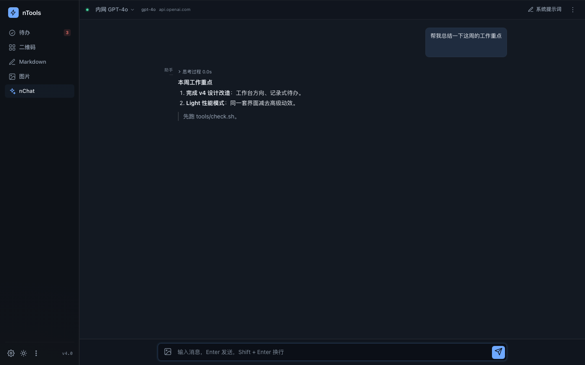
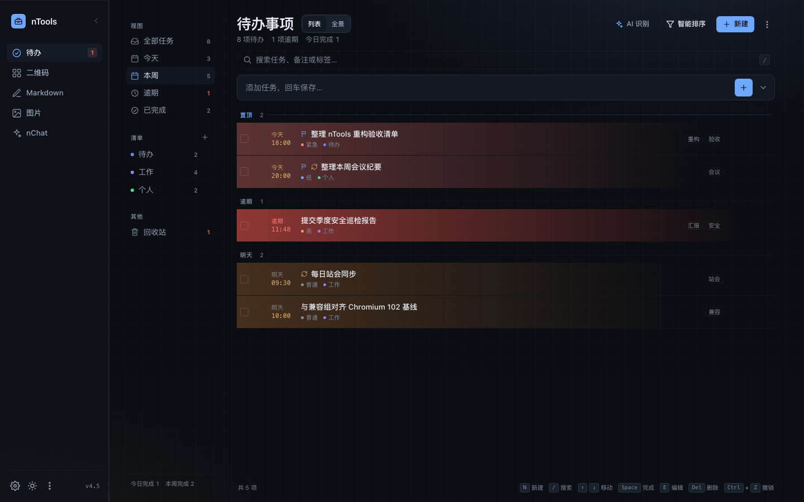
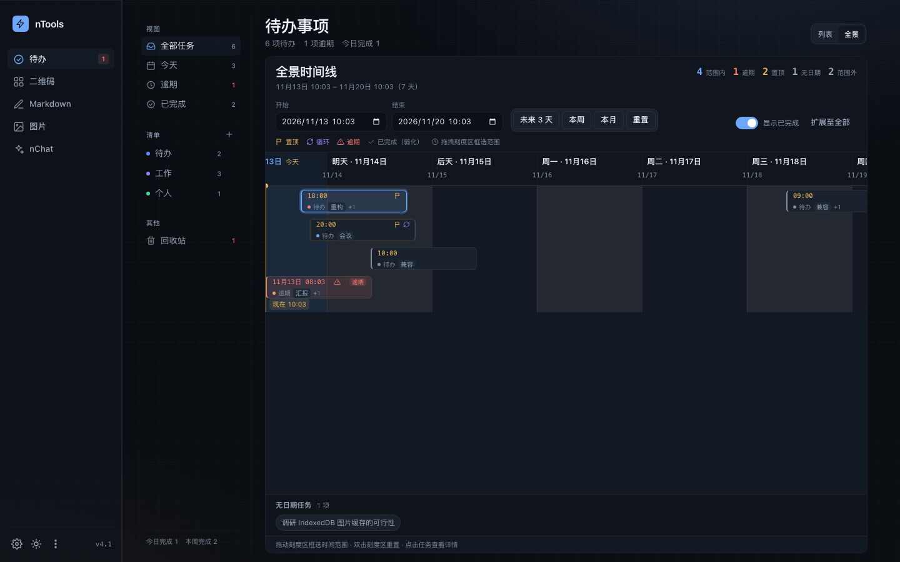
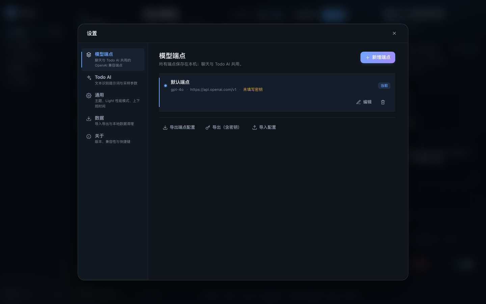

# nTools · v4.7

> 本地优先的 AI 效率工作台：nChat 原生聊天 + 待办（Todo AI 识别）+ 二维码 / Markdown / 图片工具。
> 纯静态 HTML，双击即用，无需服务器、无需安装、无需构建链；数据只留在本机浏览器。
> v4.7 采用 **Precision Workbench** 设计方向：石墨/纸面、发丝分隔、仪器蓝强调、铜色时间语义；标准模式保留完整材质与动效，**Light（Lite）模式是它的性能减法**。
> 目标环境：国企内网 / 信创 ARM / 麒麟 Linux / 奇安信可信浏览器（Chromium 102 基线）。
>
> **仓库**：[github.com/Myooooo/ntools](https://github.com/Myooooo/ntools)









## ✨ 核心特性

### 一个入口，原生聊天

- 打开 `ntools.html` 即可使用全部功能（唯一入口）；旧 `index.html` 已移除。
- **nChat 已原生嵌入**为 nTools 的一个标签页（无 iframe），与工具集共享同一套设计语言与本地数据。
- 聊天支持：流式输出、思考过程折叠、停止生成保留内容、图片多模态（最多 5 张）、Token 统计、复制/重新生成/编辑/删除、导出 Markdown、备份/恢复、按端点独立会话。

### 多模型端点（全局设置）

- 设置面板改为**居中弹窗**（侧栏齿轮 / 更多菜单 →「设置」），不再从右侧滑出；左侧分区导航 + 右侧内容，移动端全屏。统一管理**多个 OpenAI 兼容端点**：
  - 名称、Base URL、API Key、Model ID、Temperature / Top P；
  - 每个端点可单独配置**聊天系统提示词**（聊天页顶部「系统提示词」可快捷编辑）；
  - 测试连接、设为当前、导入/导出（默认不含密钥，含密钥需二次确认）。
- 聊天与 Todo AI 共用端点；Todo AI 可单独指定端点或跟随当前端点。

### Todo AI：粘贴邮件，自动识别

- 待办顶部「AI 识别」：粘贴整篇工作邮件 / 会议纪要 / 聊天记录 → 自动提取**标题、详情、截止时间、优先级、标签**。
- 识别结果**只填充创建表单，不会自动创建**：确认、修改后手动点击「添加任务」才落库。
- 系统提示词会自动注入**当前日期时间、星期、时区、下班时间**，因此“明天下班前 / 周五前 / 月底前”等相对时间能被正确换算。
- 设置面板可配置 Todo AI 的系统提示词、Temperature、Top P 与所用端点，并实时预览注入后的提示词。

### 快捷时间

创建任务时可一键填充：`下班前` `明天前` `周五前` `下周前` `月底前` `清除`。

- 下班时间默认 **17:30**，在「设置 → 通用」中修改；快捷时间会实时重算。
- 规则：下班前跳过周末；周五已过自动取下周五；下周前=下周一 09:00；月底前=本月最后一天下班时间。

### 待办（持续增强）

- 新增 / 行内编辑 / 完成 / 软删除 + 5 秒撤销 / 回收站。
- 筛选：全部 / 今天 / **本周** / 逾期 / 已完成；搜索标题、备注、标签；排序：智能 / 截止 / 创建 / 手动。
- **置顶**：任务可置顶，永远显示在列表最顶部「置顶」分组；四种排序均优先，快捷键 `P`；行内勾选框/时间/标签/操作按钮统一垂直居中。
- **详情关闭叉**：右侧详情栏右上角常显关闭按钮；打开/收起带 180ms/140ms 的位移+淡入淡出（Lite/reduced 即时）；保存=保存并关闭。
- **详情侧边栏动画**：桌面列与移动抽屉统一使用 transform/opacity，覆盖 X/保存/Esc/删除等全部关闭入口，移动端 scrim 与抽屉同步。
- **循环任务**：每天 / 每周 / 每月 / 每年；完成后同一任务自动前移到下一周期并重置为未完成，按新到期时间排序；不生成副本、不丢历史（记录完成时间）。月末/闰年自动夹取，错过多个周期会连续前移到未来。
- **三天内热区**：按日历天染色——后天到期黄色、明天橙色、**当天到期直接红色**、逾期**深红色**；完成/取消/无日期不染色。
- **回收站**：行内提供「恢复」「彻底删除」，回收站页头提供「清空回收站」（确认 + 可撤销）。
- **全景时间线**：任务条按「创建时间 → 到期时间」的真实时长绘制，自动分道、显示「现在」线；左侧视图/清单/搜索/状态筛选实时联动；范围可拖拽刻度区框选，或用起止时间/未来 3 天/本周/本月预设；默认范围自动包含创建时间，窄屏切换纵向时间流水；不显示无日期任务；点击任务在右侧覆盖抽屉打开详情，不改变时间线宽度/横向模式。
- 优先级、多清单、标签、拖拽排序、统计概览。
- 页内提醒：对齐分钟检查，页内 Toast + 标题角标 + 逾期计数；关闭页面后不提醒（纯前端限制）。
- v1 → v2 数据幂等迁移、导入导出（预览/合并/替换/自动备份）、跨标签同步。

### 其它工具

- **二维码**：文本/网址生成、尺寸选择、PNG 下载。
- **Markdown**：实时预览（DOMPurify 净化）、导入/导出 `.md`、草稿自动保存、字数统计。
- **图片 Base64**：拖拽/选择、缩放、双向转换、复制结果。

### 设计与性能

- **标准模式**：石墨/纸面配色 + 仪器蓝强调 + 铜色时间语义；发丝线代替卡片阴影；196px 工具导轨、记录式待办 ledger、访谈式聊天记录；小面积玻璃材质、环境光、有目的的入场/退场动效（仅 transform/opacity）。
- **可收起侧栏**：点击导轨右上角收起后仅显示各功能图标，logo 居中，悬浮 logo 变为展开按钮；底部只保留设置按钮；状态持久化。
- **动效审计**：基于 emilkowalski `animate` / `choreograph` 原则逐面校准——高频表面不动画、进入 ease-out / 退出更快、弹层 origin-aware、菜单可中断不叠放、设置窗口缩放淡入、时间线一次性揭示。
- **v4.5 设计复检**：按 frontend-design / apple-design / emil-design-eng 重检工具栏层级、端点列表、详情面板与侧栏——标签改为行级右栏贴按钮左缘、详情操作条粘性可达、侧栏收起/展开反馈、设置端点列表发丝分隔与显式旧配置导入。
- **Light（Lite）性能模式**：建立在标准模式之上，**去掉高级动效与页面特效**（ambient/玻璃/阴影/渐变/位移动画全部关闭），保留布局、字阶、颜色语义与即时反馈；适合低配 ARM/软渲染/长时间办公。
- 深色 / 浅色主题均基于同一套 `--nc-*` 令牌；系统「减少动效」自动降级。
- 性能：聊天 tab 懒加载（首次切到 nChat 才初始化）；待办 keyed diff + 分钟对齐 ticker；500 条任务导入/渲染/搜索在 40ms 级。
- 移动端原生基线：viewport-fit、theme-color 随主题、tap-highlight 透明、overscroll 抑制、粗指针输入 16px、safe-area、hover 能力门控。
- 无障碍：语义按钮、aria 标签、模态焦点陷阱 + Esc、`:focus-visible` 焦点环、键盘全流程。

## 🚀 快速开始

1. 下载整个文件夹（保持目录结构），建议解压后使用。
2. **首次部署先打开 `checks/compat-check.html`**，或使用左下角「⋮ → 兼容性自检」；确认内核 / 存储 / 剪贴板 / 网络能力。
3. 双击 `ntools.html`：
   - 打开「设置 → 模型端点」，新增或编辑端点（Base URL / API Key / Model ID）并保存；
   - 可选：在「设置 → Todo AI」调整识别提示词与参数；
   - 切到「nChat」开始聊天，或回到「待办」粘贴邮件用 AI 识别。

> 浏览器要求：奇安信可信浏览器（Chromium 102 基线）或 Chrome/Edge；不支持 IE / 双核兼容模式。
> 不需要 Node.js、npm、构建工具或外网。

## ⌨️ 快捷键

| 场景 | 按键 | 行为 |
|---|---|---|
| 聊天 | `Enter` / `Shift+Enter` | 发送 / 换行（中文输入法选词不误发） |
| 聊天 | `Esc` | 关闭菜单 / 系统提示词面板 / 弹窗 / 灯箱 |
| 待办 | `N` / `/` | 聚焦新建 / 搜索 |
| 待办 | `↑` `↓` / `Space` / `Enter` | 移动 / 完成 / 打开详情 |
| 待办 | `E` / `Delete` | 编辑 / 删除（进回收站） |
| 待办 | `Ctrl+Z` / `Ctrl+Shift+Z` | 撤销 / 重做 |
| 待办 | `P` | 置顶 / 取消置顶当前任务 |
| 待办 | `Alt+↑` / `Alt+↓` | 手动排序（sort=手动） |
| 待办 | `?` | 快捷键帮助 |
| AI 识别弹窗 | `Ctrl/Cmd + Enter` | 立即识别 |

## 📁 项目结构

```
ntools/
├─ ntools.html                # 唯一主应用（5 个工具 tab，含原生 nChat）
├─ checks/
│  ├─ compat-check.html       # 兼容性自检（首次部署先跑）
│  └─ tests.html              # 纯函数回归断言（双击即跑）
├─ css/
│  ├─ tokens.css              # 设计令牌（颜色/字体/间距/动效/主题/Lite）
│  ├─ base.css                # reset、排版、滚动条、焦点可见性
│  ├─ components.css          # 按钮/输入/模态/Toast/菜单等公共组件（nc-*）
│  ├─ chat.css                # 聊天（含原生嵌入样式）
│  ├─ tools.css               # 工具页与待办
│  ├─ timeline.css            # 全景时间线
│  ├─ rail.css                # 可收起侧栏
│  ├─ interaction.css         # v4.1 交互动效收口
│  └─ settings.css            # 全局设置弹窗
├─ js/
│  ├─ vendor：marked / purify / qrcode（本地）
│  ├─ 基础设施：theme-boot / polyfills / core / compat / icons / storage / ui / theme
│  ├─ 数据与 AI：schema-chat / schema-todo / llm-store / ai / settings-panel
│  ├─ 聊天：settings-store（适配层）/ conversation-store / sse / api /
│  │        message-view / composer / settings-view（系统提示词 sheet）/
│  │        chat-controller / chat-embed（组合根）
│  ├─ 待办：todo-store / todo-view / todo-ai / todo-time / todo-timeline / todo
│  ├─ 工具：qr / markdown / image
│  └─ 组合根：ntools-app
├─ docs/
│  ├─ architecture.md         # 架构、分层、存储键、事件
│  ├─ compatibility.md        # 兼容性结论与现场验证步骤
│  ├─ design-direction-v4.md  # 设计方向/令牌/动效/Light 定义
│  ├─ design-break-audit.md   # 最坏数据/移动端原生审计
│  ├─ animation-audit-v4.1.md # 全站动效审计与修复记录
│  ├─ timeline-view.md        # 全景时间线调研/API/交互与限制
│  ├─ design-review-v4.5.md   # v4.5 聊天/设置设计复检
│  ├─ design-qa-v4.5.md       # v4.5 全页面设计 QA 报告
│  ├─ v4-design-report.md     # v4 设计改造与验收报告
│  ├─ v45-release-report.md   # v4.5 设计复检/交互修复/端点兼容交付报告
│  ├─ v46-release-report.md   # v4.6 本周视图/详情动画交付报告
│  └─ v47-release-report.md   # v4.7 全景视图详情抽屉交付报告
├─ tools/
│  ├─ verify.js               # CDP 页面验收（报错/DOM/迁移/原生聊天/设置面板 + 截图）
│  ├─ e2e.js                  # 回归交互（待办/聊天流式/安全/性能）
│  ├─ e2e-features.js         # 功能 E2E（端点/系统提示词/Todo AI/快捷时间）
│  ├─ e2e-timeline.js         # 全景时间线 E2E（58 断言 + 截图）
│  ├─ e2e-v41.js              # 交互/置顶/循环/热区/回收站/侧栏/设置弹窗/时间线 E2E
│  ├─ break-ui.js             # 最坏数据 + 响应式 + 移动端原生审计
│  ├─ design-shots.sh         # v4 设计截图归档（标准/浅色/Lite × 桌面/移动）
│  ├─ run-tests.js            # 无头运行 checks/tests.html
│  └─ check.sh                # 一键全量验收
└─ img/                       # README 截图
```

## 🔐 数据与隐私

- 全部数据保存在本机浏览器 `localStorage`；除你配置的模型端点外，不向任何服务器发送数据。
- 主要存储键：
  - `ntools.llm.v1`：模型端点、聊天系统提示词、Todo AI 配置、下班时间；
  - `nchat-conversation.v2`：按端点隔离的聊天会话；
  - `ntools.todo.v2`：待办文档（含回收站、导入隔离区）；
  - `nchat-theme` / `nchat-lite-mode`：主题与 Light（Lite）性能模式。
- 旧版 `nchat-settings` / `nchat-conversation` 会在首次启动时自动迁移，原键保留用于回滚；即使 `ntools.llm.v1` 已存在，也会一次性合并旧 nChat 端点（保留旧 id 以兼容旧会话），设置 → 模型端点可手动「从旧 nChat 导入」。
- 导出端点配置默认**不含 API Key**；勾选含密钥需二次确认。
- 升级/迁移前自动备份；`file://` 下本地页面共享同一存储域（Chromium 行为），共用电脑建议用后清理。

## 🔧 兼容性与部署

- **基线**：Chromium 102（奇安信可信浏览器公开内核时间线 83→132，实际以目标机为准）。
- **以 `file://` 双击运行为主**：不使用 ES Module / 本地 fetch / Service Worker；升级直接覆盖文件夹，数据按源共享。
- **内网 API 网关要求**（`file://` 请求带 `Origin: null`，JSON + Authorization 触发 OPTIONS 预检）：
  - `Access-Control-Allow-Origin: *`（本应用跨源不带 Cookie）；
  - `Access-Control-Allow-Headers: authorization, content-type`；
  - `Access-Control-Allow-Methods: POST, OPTIONS`；
  - 若网关不支持，可改用内网 nginx 同源静态托管/反代。
- 通知：`file://` 下 Notification 权限被拒 → 待办只用页内提醒；剪贴板可用并保留 `execCommand` 兜底。
- 字体：内置 CJK 字体栈；无需外网字体。
- Light（Lite）性能模式：低配/软渲染机器建议开启；系统「减少动效」会自动适配。

## 🧪 开发与验收

无构建链：修改后直接刷新浏览器；新增模块按 `ntools.html` 中经典 `<script defer>` 顺序加载。

```bash
# 一键全量验收（语法 + 页面 + 3 套交互/功能 E2E + 时间线 + v4.1 + 纯函数）
bash tools/check.sh

# 分项
node tools/verify.js          # 页面级（ntools + checks 两页；DOM/迁移/原生聊天/设置面板 + 截图）
node tools/e2e.js             # 回归交互（待办/聊天流式/安全/性能）
node tools/e2e-features.js    # 功能回归（多端点/系统提示词/Todo AI/快捷时间）
node tools/e2e-timeline.js    # 全景时间线（mount/框选/点击/响应式/500 条）
node tools/e2e-v41.js         # v4.1 交互（菜单/设置弹窗/侧栏/置顶/循环/热区）
node tools/run-tests.js       # checks/tests.html 断言（无头）
open checks/tests.html        # 或双击运行
```

- 最近验收结果：`bash tools/check.sh` **7/7 全绿**（verify 3 页、回归 E2E、功能 E2E 53 项、时间线 E2E 58 项、交互/回收站 E2E、纯函数 81 项，全部 PASS / 0 FAIL）；`break-ui` 32 组最坏数据 0 问题、移动端原生 12/12 PASS。
- 截图输出：`/tmp/nc-shots/task29/`（v4.7 全景详情抽屉）、`/tmp/nc-shots/v45/qa/`（v4.5 全页面设计 QA）。

## ❓ 常见问题

| 现象 | 排查 |
|---|---|
| 页面空白 / 按钮无反应 | 打开 `checks/compat-check.html`；确认 js/css 目录完整；`chrome://version` 记录内核 |
| 聊天或 Todo AI 报网络失败 | 多半是 CORS：网关放行 `Origin: null` + OPTIONS，见上文 |
| 401 / 模型不存在 | 检查 Base URL、API Key、Model ID；设置面板「测试连接」可直接验证 |
| AI 识别结果不准 / 时间为空 | 调整「设置 → Todo AI」提示词；确认端点模型支持中文 JSON 输出 |
| 快捷时间与预期不符 | 检查「设置 → 通用 → 下班时间」；规则见上文 |
| 待办提醒不弹系统通知 | `file://` 下通知被拒，设计上只用页内提醒 |
| 升级后仍是旧界面 | 落实覆盖文件；关闭标签页重开或强制刷新 |
| 旧聊天记录看不到 | 「设置 → 模型端点」选择迁移后的旧端点；旧会话按端点保留 |

## 🗒️ 版本变更

### v4.7（当前）

- 修复全景视图点击任务无法打开侧边详情：timeline 模式详情改为右侧覆盖抽屉（220ms ease-drawer），时间线宽度/横向模式/滚动位置保持不变；点击另一任务可切换详情，X/保存/Esc/scrim/删除关闭后仍保持时间线挂载。
- `check.sh` 7/7；e2e-v41 新增 6 条 v4.7 断言；e2e-timeline 58/58；版本 v4.7.0。

### v4.6

- Todo 新增「本周」视图（周一–周日；计数/badge/空状态/移动 chips 同步；旧非法 view 自动回退）。
- 详情侧边栏加入规范动画：打开 180ms opacity+translateX、关闭 140ms（退出更快），覆盖 X/保存/Esc/删除；移动抽屉 scrim 同步延迟隐藏；Lite/reduced 即时；快速开合可中断。
- `check.sh` 7/7；e2e-v41 新增 9 条本周/动画断言；tests 81/81。

### v4.5

- 设计复检：侧栏收起后 logo 居中且悬浮变展开按钮；Todo 标签改为行级右栏、贴操作按钮左缘并对齐中线；详情操作条粘性可达；设置端点列表发丝分隔/对比度/端点计数/显式「从旧 nChat 导入」；聊天工具栏层级与端点元信息强化。
- 详情交互：关闭叉真正收起（清空选中，桌面列/移动抽屉同步）；「保存」= 保存并关闭。
- nChat 端点兼容：`ntools.llm.v1` 已存在时也会合并旧 `nchat-settings`（两种旧形状、字段归一、去重、保留旧 id/currentId、只导入一次、不复活）。
- 版本 v4.5.0；`check.sh` 7/7；新增 `design-review-v4.5` / `design-qa-v4.5`。

### v4.4

- 到期染色改为日历天语义：后天黄、明天橙、**当天红**、逾期深红；超过 3 个日历天不染色。
- 回收站行操作改为「恢复 / 彻底删除」，页头新增「清空回收站」按钮（确认 + 撤销）。
- 仓库清理：删除 8 份过期 docs（v1 方案、v2/v3 报告、旧 dev-contract、v4.1–v4.3 发布报告），保留架构/兼容性/设计/动效/时间线/设计报告；代码与工具文档注释同步更新。
- 无缓存/临时/未引用资产残留；版本 v4.4.0。

### v4.3

- 品牌图标与 favicon 改为工具箱（toolbox）；左上角 nTools mark 同步更新。
- Todo 行内标签为右侧操作按钮预留 92px 并截断，不再重叠；循环图标移到标题左侧（置顶图标右侧）。
- 详情右下角「完成」改为「保存」（flush 编辑 + 已保存提示，不关闭抽屉）；完成状态由左上角勾选框负责。
- 清理旧入口与脚本：删除 `index.html`、`tools/screenshot.sh`、`tools/shots-v3.sh`；`tests.html` / `compat-check.html` 收纳到 `checks/`；工具链路径同步。
- 左下角「⋮」菜单与「关于 nTools」弹窗新增「兼容性自检」「回归测试」入口；设置→关于入口同步新路径。
- 验收：`check.sh` 7/7；verify 3 页；纯函数 81/81。

### v4.2

- Todo 行内元素垂直居中、详情右上关闭叉、示例数据新增每日/每月循环任务。
- 全景时间线：任务条改为创建→到期的真实时长条、移除无日期任务、范围控件对齐、左侧视图/清单/搜索/状态筛选联动、默认范围数据化（含创建时间）、切换按钮位置稳定且带 180ms 淡入。
- 侧栏收起后 logo 居中，悬浮变为展开按钮。
- `check.sh` 7/7 全绿；e2e-timeline 58 断言、e2e-v41 增加 v4.2 四态/对齐断言。

### v4.1

- 交互修复：Todo/全局菜单重复点击不再叠放（单例 + 退出动画）、设置改为**居中弹窗**、侧栏**可收起**（图标模式，底部只留设置）、补齐菜单/弹层/设置/侧栏/待办/聊天的入场与退场动效并做全站动效审计。
- Todo 新能力：**置顶**、**每日/每周/每月/每年循环任务**、**三天内到期整行黄→红热区渐变**、新建按钮快捷键提示调整（N 移到列表底部）。
- 新增 **全景时间线**：按到期时间排布、自动分道、现在线、范围拖拽框选 + 起止输入 + 预设；窄屏纵向流水；独立模块 `NC.timeline`。
- 移动端详情抽屉改为底部上滑；新增 `rail/timeline/interaction` 样式层；`check.sh` 增至 7 阶段。
- 验收：`bash tools/check.sh` 7/7 全绿；时间线 E2E 40/40；v4.1 E2E 17/17；纯函数 81/81。

### v4

- 设计方向升级为 **Precision Workbench**：石墨/纸面 + 发丝线 + 仪器蓝/铜色语义；工具导轨、记录式待办 ledger、访谈式聊天、检查器设置面板全面重做。
- 标准模式补全高级效果与细腻动效；**Light（Lite）模式 = 标准模式的减法**（去 ambient/玻璃/阴影/渐变/位移/缩放与不必要的动画），同一套令牌派生。
- 移动端原生基线：viewport-fit、theme-color 动态、tap-highlight、overscroll、粗指针 16px、safe-area、84/84 hover 能力门控。
- 可访问性对比度修正（浅色 text-3/accent/time/danger 等）、popover origin-aware、图标按钮尺寸修复。
- 新增 `break-ui` / `design-shots` 工具与 32 组最坏数据审计；验收 118 PASS / 0 FAIL，纯函数 81/81。

### v3

- nChat 原生嵌入 nTools（移除 iframe），旧入口自动跳转；聊天 tab 懒加载。
- 多模型端点提升为全局设置（增删改/测试/导入导出/密钥脱敏），聊天按端点独立系统提示词与会话。
- Todo AI：粘贴邮件自动提取标题/详情/截止/优先级/标签，填充后可编辑、手动创建；提示词自动注入当前日期时间。
- 快捷时间：下班前/明天前/周五前/下周前/月底前，下班时间可配置。
- 设置面板：模型端点 / Todo AI / 通用 / 数据 / 关于五个分区。
- 设计升级与性能优化；新增 53 项新功能 E2E + 81 项纯函数断言。

### v2

- 分层重构（经典脚本 + IIFE）、安全修复（XSS/导入校验/密钥脱敏）、SSE 健壮化、Todo 全面增强、统一设计令牌、验收工具链。

## 📄 许可

本项目采用 [MIT License](LICENSE) 开源。第三方依赖及许可见 [THIRD_PARTY_NOTICES.md](THIRD_PARTY_NOTICES.md)。
