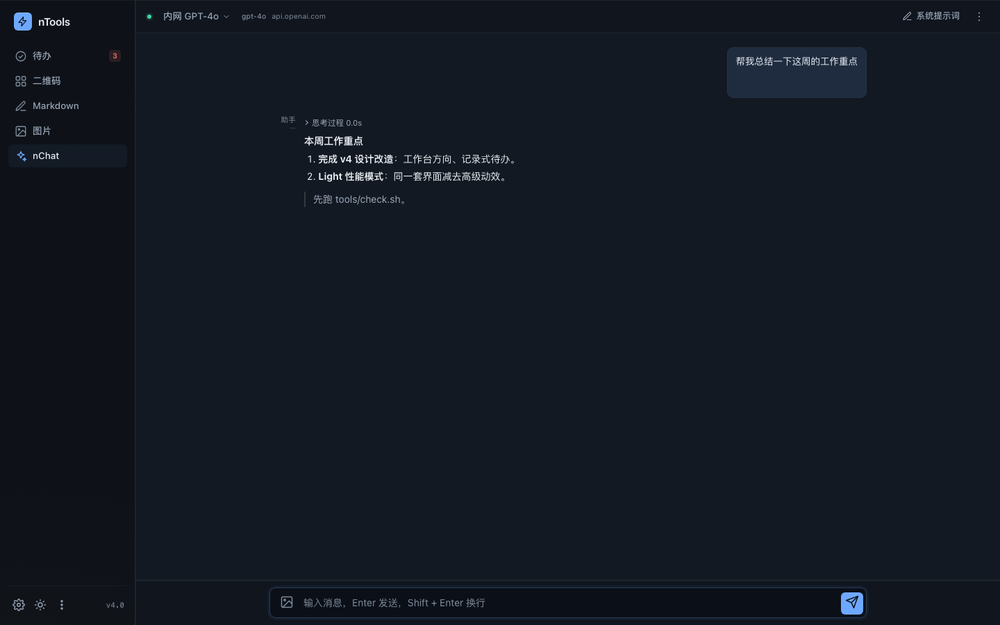

# nTools

本地优先的 AI 效率工作台：**nChat 聊天 + 待办（Todo AI 识别）+ 邮件管理 + 二维码 / Markdown / 图片工具**。

纯静态 HTML，双击即用，无需服务器、安装或构建；所有数据只保存在本机浏览器。

## 使用

1. 下载整个文件夹并保持目录结构。
2. 双击 `ntools.html` 打开（推荐 Chromium 102+，支持奇安信可信浏览器 / Chrome / Edge）。
3. 首次使用：点击左下角齿轮 →「模型端点」添加一个 OpenAI 兼容端点；需要 Todo AI 时再配置「Todo AI」。
4. 环境确认：左下角「⋮」→「兼容性自检」；纯函数回归选「回归测试」。
5. 邮件管理：左侧「邮件」tab 使用本地 `email/email-manager.html`，内网无需外网；部署时请将该文件与主程序一起拷贝（该第三方文件不提交到 Git 仓库）。

> 不使用 ES Module、构建产物或外网资源；全部功能可离线运行。

## 配置

### 模型端点

- 设置 →「模型端点」→「新增端点」：填写 **Base URL**、**API Key**、**Model ID**；Base URL 只填 OpenAI 兼容 base（可带 `/v1`，也可只填 host），**无需填写 `/chat/completions`**，运行时会自动补全。
- **API 格式**：默认 `openai`（标准 OpenAI Chat Completions）；可选 `bocai`（BOCAI 网关：附带稳定 `sessionId`，不支持图片输入）。
- 支持多个端点：可测试连接、设为当前、复制、导入/导出；聊天与 Todo AI 共用端点。
- 每个端点可单独设置聊天系统提示词；API Key 只保存在本机。
- 旧版 nChat 的端点配置会自动合并；也可在端点列表底部点击「从旧 nChat 导入」。

### 聊天与 Todo AI

- **nChat**：多会话列表（按今天/昨天/更早分组、自动标题、重命名/删除、可收起）、消息分支（编辑/重新生成/版本切换）、流式回复与思考过程、停止生成、图片与文本附件（支持拖拽/粘贴）、KaTeX 数学公式、代码块复制、Token 统计、按端点独立会话与系统提示词。
- 会话数据存放在 **IndexedDB**（浏览器不支持时回退 `nchat-conversation.v3` localStorage）；旧版 v3/v2/v1 数据首次启动自动迁移为“旧会话”，旧键保留可回退。
- 端点能力可在设置中开关：图片输入、文本附件；关闭后 nChat 会禁用对应入口。
- **Todo AI**：设置 →「Todo AI」选择端点并配置系统提示词、Temperature、Top P；提示词自动注入当前日期时间、星期、时区及下班时间。识别可自动填充循环任务（每天/每周/每月/每年）；识别弹窗可临时选择模型端点，并记住上次选择；Todo AI 始终使用 Todo 提示词，不拼接端点的聊天系统提示词。

### 通用

- 设置 →「通用」：深色/浅色主题、**Light 性能模式**（关闭高级动效与页面特效）、下班时间（用于「下班前」等快捷时间）。
- 快捷时间：下班前 / 明天前 / 周五前 / **下周五前（下周前）** / 月底前 / 清除（清除按钮为红色危险样式）。

### 内网网关（CORS）

`file://` 打开时请求 `Origin: null`，内网网关需放行：

- `Access-Control-Allow-Origin: *`
- `Access-Control-Allow-Headers: authorization, content-type`
- `Access-Control-Allow-Methods: POST, OPTIONS`

## 数据与隐私

- 所有数据（端点、会话、待办）保存在本机浏览器 `localStorage`，仅访问你配置的模型端点。
- 旧版 `nchat-settings` / `nchat-conversation` 首次启动自动迁移。
- 清理浏览器或换电脑前，请在「设置 → 数据」导出备份。

## 许可

[MIT License](LICENSE)
